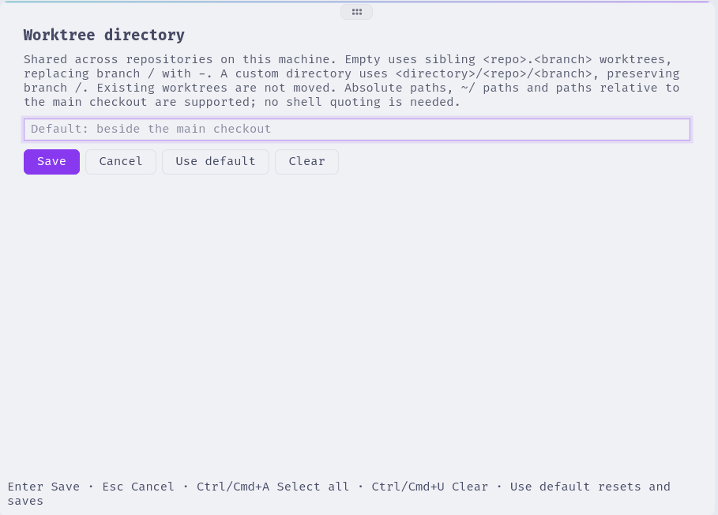

# tern-worktree

A [Tern](https://docs.stencil.so/tern/) plugin for managing Git worktrees from the command palette. It uses Git directly to list, open, create, and remove worktrees.




Tested with Tern 0.6.3 and Git 2.55.0.

## Requirements

- `tern`, `git` and `jq` on your PATH
- a POSIX `sh`

## Install

Install from GitHub:

```sh
tern plugin install github.com/nibblebot/tern-worktree
tern plugin list
```

The plugin is registered as `worktree` and should report `ready`. Installing reloads plugins automatically. To update, run the install command again with `--force`.

To develop against a local checkout instead, link it (a linked plugin reloads when its files change):

```sh
git clone https://github.com/nibblebot/tern-worktree
cd tern-worktree
tern plugin link "$PWD"
```

## Usage

Focus a terminal pane in a Git repository and open **Worktree: Worktrees** from Tern's command palette. Repeating the command focuses the existing picker without resetting its state; after closing it, the command opens a fresh pane below the focused pane. The picker lists two groups:

- **Worktrees**: every worktree of the repository (the branch name, or `(detached <sha>)`), with its path. Press **Enter** to open it in a new tab and focus the tab.
- **Branches**: local branches that have no worktree, with their latest commit. Press **Enter** to create a worktree for the branch and open it in a new tab.

Type a new branch name to get a **Create '<name>' worktree** entry. It creates the branch and its worktree and opens it in a new tab. If a local branch with that name already exists, the existing branch is used instead of failing.

Press **Delete** to remove the selected linked worktree. On a keyboard without a forward-delete key, press **Fn+Delete**. **Backspace** still deletes the last character of the filter.

Delete opens a sheet titled **Remove worktree**. **Remove** or **Enter** deletes that worktree and leaves its branch. **Cancel** or **Esc** returns to the list and does not run Git. While the main checkout is selected, the dock reads `main checkout stays` and **Delete** does not open the sheet. **Delete** on a branch row, or on the create row, explains why and does not run Git.

After a remove, the picker stays open and reloads. When that worktree was on a branch, the branch is selected under **Branches**. Git refuses a dirty or locked worktree. The picker shows Git's output. That sheet has no force button.

The filter accepts only letters, digits, `.`, `_`, `/` and `-`; other characters are dropped as you type. Branch names containing `+`, `@` or `#` can't be created from the picker.

If a command fails, its output is shown in the picker.

### Worktree behavior

- An existing registered worktree for the selected branch is reused, regardless of the configured directory.
- Worktree paths are passed literally, preserving spaces and newlines, including trailing newlines.
- By default, a new worktree is created beside the main checkout at `<repo>.<branch>`, with `/` in the branch name replaced by `-`, even when invoked from a linked worktree. For example, branch `feature/login` in repository `/projects/app` uses `/projects/app.feature-login`.
- Git creates missing parent directories as needed. If the destination already exists or is already registered as a worktree, creation fails safely rather than overwriting it. Under the default layout, different branch names can map to the same destination, such as `feature/login` and `feature-login`.
- A new branch starts from `origin/HEAD` when available, otherwise local `main`, then local `master`, then `HEAD`.
- Remove runs `git worktree remove` from the main checkout, with no `--force`. It does not delete the branch, and it does not take the configured directory.
- A path Git does not list is left on disk. Removing that path again does nothing.

## Configuration

Open **Worktree: Configure directory** from Tern's command palette to set the parent directory for new worktrees. Repeating the command focuses the existing configuration pane without resetting its input; after closing it, the command opens a fresh pane below the focused pane. The input is prefilled with the current value. Press **Enter** or click **Save** to persist the value; press **Esc** or click **Cancel** to leave it unchanged.

The setting is stored locally in Tern's plugin store and shared across this machine's plugin windows and repositories. There is no per-repository setting.

Absolute paths are used directly. Relative paths are resolved against the main checkout, not the invoking linked worktree. A literal `~` or `~/` prefix is expanded using your home directory; for example, enter `~/worktrees`.

New worktrees use `<configured-dir>/<repo>/<branch>`, preserving `/` components in the branch name as directories. For example, `/projects/app` and branch `feature/login` use `$HOME/worktrees/app/feature/login` with `~/worktrees` configured. Existing registered worktrees are reused and are not moved when the setting changes.

Save an empty value or click **Use default** to restore the default: new worktrees are created beside the main checkout as described above.

## Keys

| Key | Action |
| --- | --- |
| type | filter (fuzzy, over name and path or commit) |
| ↑ ↓, Ctrl+P / Ctrl+N, Tab / Shift+Tab | move the selection |
| Enter | open, check out or create the selected entry |
| Delete | remove the selected linked worktree, after confirm |
| Esc | clear the filter; with an empty filter, close. On the confirm sheet, return to the list |
| Ctrl+U, Ctrl+W | clear the filter, delete the last word |
| Ctrl+R | reload the list |

## Keybinding

Optionally bind the picker to a key. Add this to `keybinds` in Tern's `settings.json` (`~/.config/tern/settings.json` on Linux, or `$TERN_CONFIG_DIR/settings.json` when set), merging it with your existing settings:

```json
{
  "keybinds": {
    "alt+shift+z": ["plugin.worktree.open_worktrees"]
  }
}
```

Save the settings and reopen the Tern window to load the binding.

## License

MIT. See [LICENSE](LICENSE).
